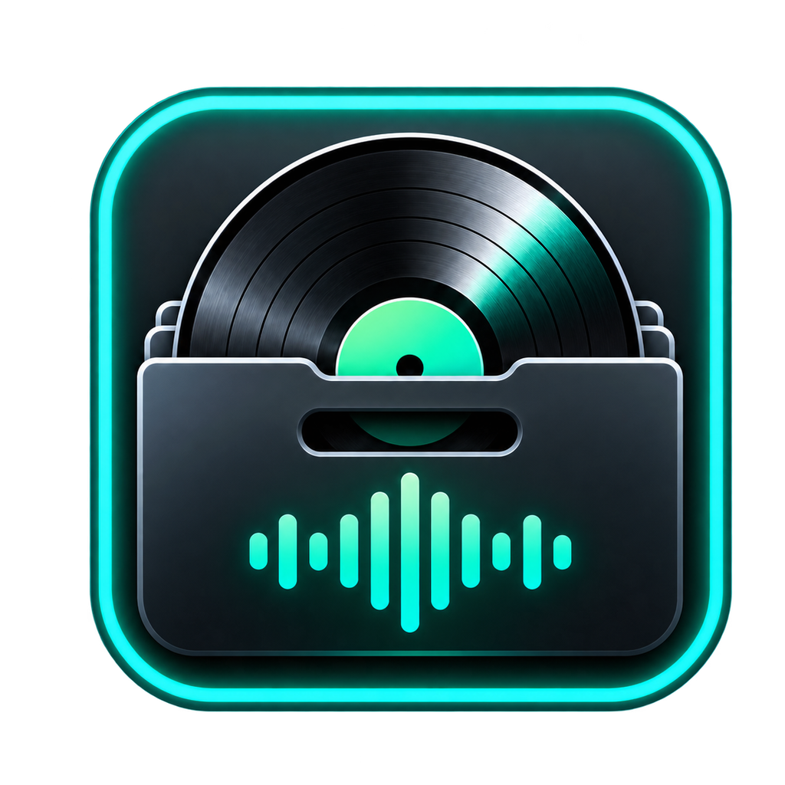

<div align="center">



# DeckReady

**Prepare and organize your music for Serato DJ Pro and Lite.**

Organize › Prepare › Play

[](https://github.com/YourCyanDev/DeckReady/actions/workflows/build-windows-release.yml)
[](https://github.com/YourCyanDev/DeckReady/releases)


[](https://discord.gg/BuVnCQ5fG9)

[Overview](#overview) · [Features](#features) · [Downloads](#downloads) · [Getting started](#getting-started) · [Development](#development) · [Roadmap](#roadmap) · [Support](#support) · [License](#license-and-disclaimer)

</div>

---

## Overview

DeckReady helps you get downloaded music into an organized library and prepare it for Serato. Import tracks, review their metadata, check for duplicates, and choose how the files are stored before your next set.

**Download → DeckReady → Serato**

DeckReady is in alpha. Features and packaging can differ between platforms and builds. Keep backups of important music and Serato library data when testing.

## Features

### Import and organize

- **Flexible imports:** individual songs, multiple tracks, folders, ZIP archives, drag and drop, and application-menu imports in supported builds.
- **Watched import folder:** automatically process music placed in the DeckReady Inbox on Windows or DeckReady Imports on macOS. Useful for browser downloads and other apps that save music to a folder.
- **Automatic organization:** sort imported music using information such as artist, genre, and year.
- **Copy or move:** keep the original files and create organized copies, or move the originals into your DeckReady library.
- **ZIP processing:** extract supported audio, read track information, check for duplicates, and organize successful imports.

### Review your library

- Read track details such as title, artist, album, genre, and year; edit metadata for supported audio formats.
- Detect previously imported music, including renamed files, and review duplicate results.
- Search the DeckReady collection and preview audio before importing.
- Review recent imports and persistent import history in supported builds.
- Locate imported music in Finder on macOS.

### Prepare for Serato

- Detect Serato DJ Pro and Lite and prepare music for supported crate and library workflows.
- Handle synchronization and offer to open Serato after supported imports.
- Mark updates as **Waiting for Serato** when a restart is needed, with **Quit & Reopen Serato** or **Restart Later** options.
- Use backup-focused behavior before supported library changes.

### Keep your workflow consistent

- Remember library locations, organization, copy/move choices, cleanup settings, and Serato preferences between sessions.
- Optionally clean up source files after a successful import or duplicate confirmation, with safeguards to protect library files.
- Use logs to troubleshoot imports, metadata, file movement, watched folders, Serato synchronization, and application errors.
- Open GitHub, Discord, and issue reporting from the Help menu, available since a1.07.0.

### Nested artist crates (upcoming Windows version)

In **Settings → Import Behavior → Organize by**, choose **Year → Artist (songs inside)**.
New files are stored as `Library/2026/Yo DJ Hill/song.mp3`. With Serato sync enabled,
DeckReady creates a **2026** crate and a **Yo DJ Hill** subcrate containing the tracks.
Songs are tracks, not another crate level. This mode uses year/artist names instead of
the single crate-name setting. Tracks missing either a year or artist go only to the **need tag editing** crate.
Their storage folders use **Unknown Year** / **Unknown Artist** until tags are filled in.
Choose **Genre → Artist (songs inside)** for a genre crate with artist subcrates,
such as **Hip-Hop → Yo DJ Hill**, and matching `Library/Hip-Hop/Yo DJ Hill/` folders.
Missing genre or artist tags send tracks to **need tag editing** in that mode.
Existing files are not reorganized; existing crate contents are retained.

## Downloads

Get testing builds from **[GitHub Releases](https://github.com/YourCyanDev/DeckReady/releases)**. Open the release for your platform and choose its download under **Assets**.

| Platform | Downloads | Notes |
| --- | --- | --- |
| Windows | `.exe`, `.msi` | Alpha builds; MSI installation is still being refined. |
| macOS | `.dmg`, `.pkg` | Native macOS app; check the release notes for the build you download. |
| iPhone and iPad | [iOS source alpha](https://github.com/YourCyanDev/DeckReady/pull/1) | Separate development branch and draft PR; not an App Store or TestFlight release. |

Platform versions can differ. Check the relevant release notes rather than assuming the latest tag applies to every platform.

## Getting started

1. Download the appropriate build from [Releases](https://github.com/YourCyanDev/DeckReady/releases).
2. Install or open the app using the package provided for your platform.
3. Open Settings and choose your DeckReady library location, copy/move behavior, and organization preferences.
4. Import a few songs or a folder. You can also use a ZIP or the watched import folder in supported builds.
5. Review the import results, metadata, and duplicates, then complete the Serato workflow available in your build.
6. If tracks are marked **Waiting for Serato**, use the restart option when you are ready.

Start with a small collection while testing an alpha build. Enable source cleanup only after reviewing how it fits your workflow.

## Development

### Windows

The source on `main` is built with **C#, .NET 8, and WPF**. Install the .NET 8 SDK on Windows, then clone the repository:

```powershell
git clone https://github.com/YourCyanDev/DeckReady.git
cd DeckReady
dotnet run --project .\src\DeckReady.Windows\DeckReady.Windows.csproj
```

To build packages from the repository root:

```powershell
& ".\Build Windows EXE.bat"
& ".\Build Windows MSI.bat"
```

The EXE builder writes to `release\win-x64`. The MSI builder writes to `release\msi`. You can also run **Build Windows Release** manually from [GitHub Actions](https://github.com/YourCyanDev/DeckReady/actions/workflows/build-windows-release.yml) and download its artifacts after a successful run.

### macOS

Use the macOS assets and notes on the [Releases page](https://github.com/YourCyanDev/DeckReady/releases). The current `main` branch contains the Windows source; it does not include a macOS Xcode project.

### iPhone and iPad

The first SwiftUI alpha is being developed in [`ios/first-alpha`](https://github.com/YourCyanDev/DeckReady/tree/ios/first-alpha), tracked in [PR #1](https://github.com/YourCyanDev/DeckReady/pull/1). It covers local imports, previews, saved crates, and folder exports through Files for Serato DJ for iOS. Open the Xcode project on a Mac to build it. Physical-device import/export testing remains part of that work.

## Roadmap

- Expand metadata editing and supported-format handling.
- Improve Serato integration and Pro/Lite detection.
- Add more import customization and clearer progress reporting.
- Improve duplicate handling, error messages, and diagnostics.
- Refine the interface, performance, and reliability.
- Improve Windows EXE/MSI packaging and macOS PKG distribution.
- Add automatic update support.

See the [changelog](CHANGELOG.md) for recorded changes and [issues](https://github.com/YourCyanDev/DeckReady/issues) for reported problems and suggestions.

## Support

**Found a bug?** [Open an issue](https://github.com/YourCyanDev/DeckReady/issues) with:

- DeckReady, operating system, and Serato versions.
- What you were trying to do and the steps to reproduce it.
- Expected behavior and what actually happened.
- Relevant screenshots and logs.

Please do not upload copyrighted music files to public issues.

**Have a feature idea?** Explain what you want DeckReady to do, how you handle the task today, and how the change would help your workflow.

For discussion and help, join the **[DeckReady Discord](https://discord.gg/BuVnCQ5fG9)**.

## License and disclaimer

The repository's [alpha software license and notice](installer/Assets/License.rtf) states **Copyright YourCyanDev. All rights reserved.** This README does not grant an open-source license.

DeckReady is an independent project and is not affiliated with, endorsed by, sponsored by, or officially associated with Serato Limited. Serato and Serato DJ are trademarks of their respective owners.

Alpha builds may contain bugs, incomplete features, metadata edge cases, import failures, or synchronization issues. Keep backups of important music and Serato data, and review file-handling and cleanup settings before use.
